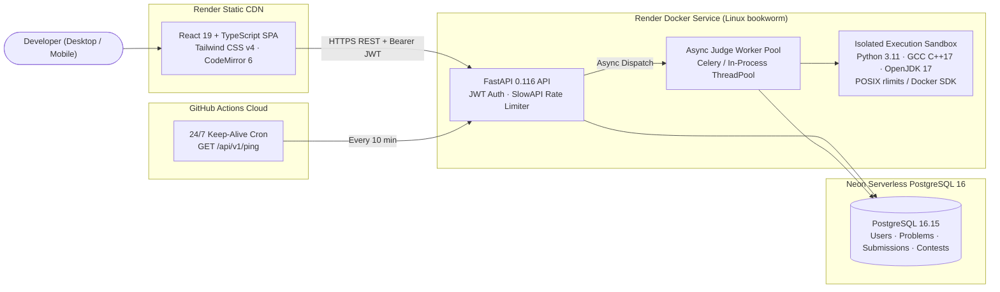
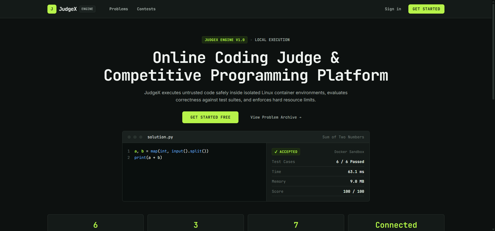
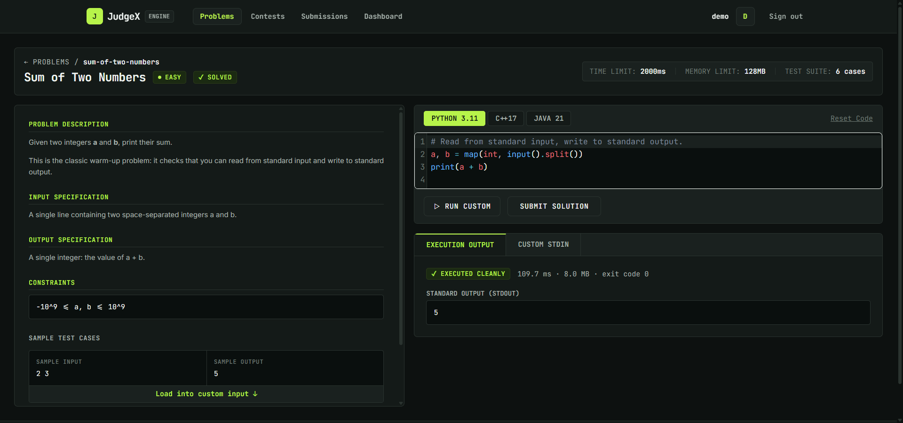
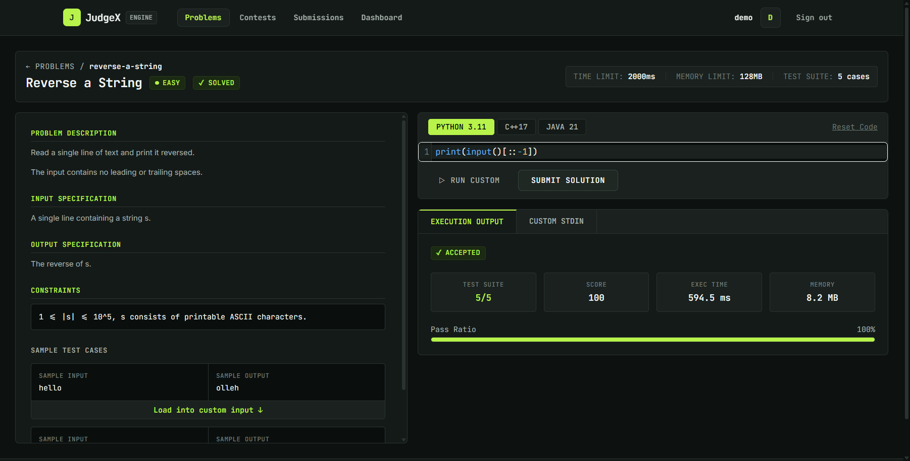
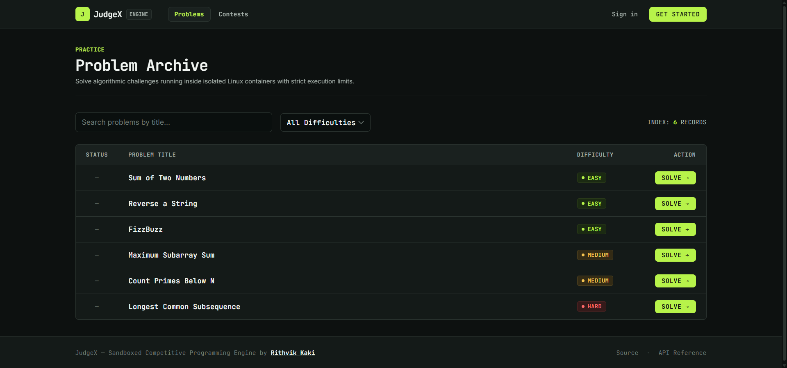
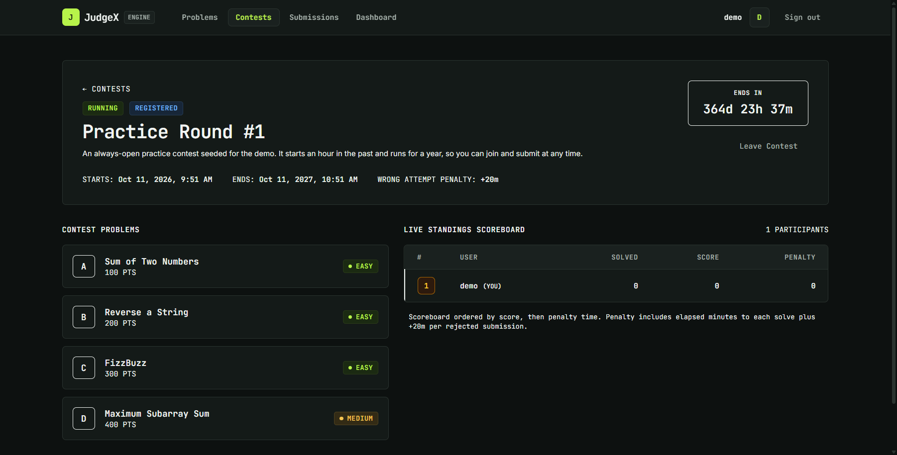
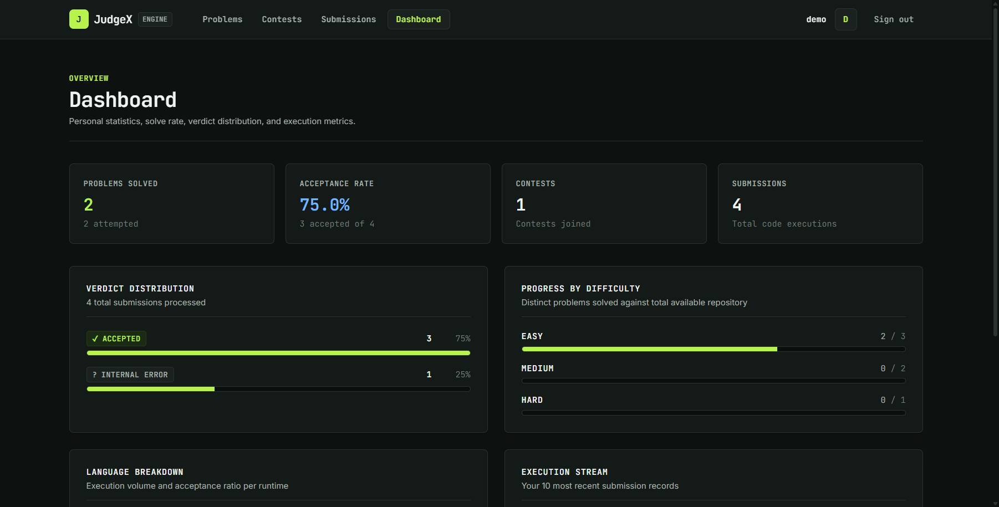
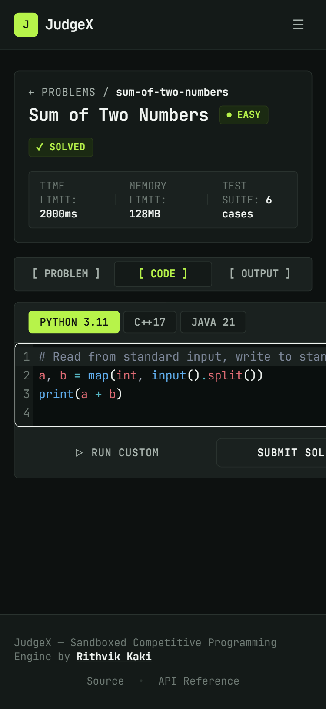
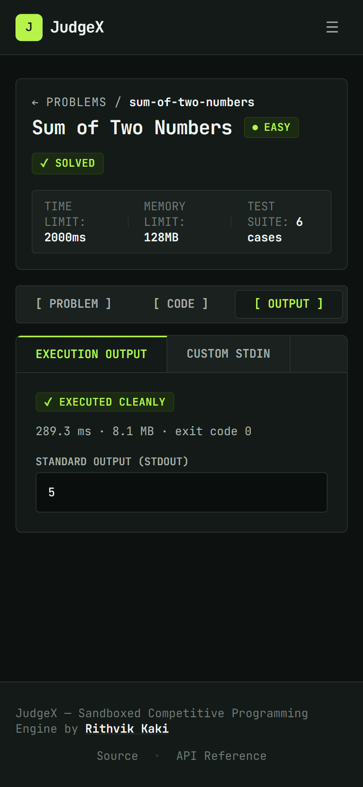

# JudgeX — Online Coding Judge & Execution Engine

[](https://judgex-web.onrender.com)
[](https://judgex-api.onrender.com)
[](https://judgex-api.onrender.com/docs)
[](https://github.com/rithvikkaki/JudgeX/actions/workflows/keepalive.yml)

**A modern, production-grade competitive programming judge that compiles, sandboxes, and evaluates untrusted code in Python, C++, and Java with real-time telemetry across Desktop and Mobile.**

---

## 🌐 Live Production Deployment (24/7 Cloud)

| Service | Live URL | Details |
| :--- | :--- | :--- |
| **Frontend Web Application (Desktop & Mobile)** | **[https://judgex-web.onrender.com](https://judgex-web.onrender.com)** | React 19 + TypeScript + Tailwind CSS v4 + CodeMirror 6 on Render Global CDN |
| **Problems Archive** | **[https://judgex-web.onrender.com/problems](https://judgex-web.onrender.com/problems)** | 6 curated algorithmic problems (Easy, Medium, Hard) with sample & hidden test suites |
| **Live Practice Contest & Standings** | **[https://judgex-web.onrender.com/contests](https://judgex-web.onrender.com/contests)** | Real-time ICPC-style contest registration, problem scoring, and live leaderboard |
| **Backend REST API** | **[https://judgex-api.onrender.com](https://judgex-api.onrender.com)** | FastAPI 0.116 + Dockerized `python3` / `g++` / `openjdk-17` execution sandbox |
| **Interactive Swagger / OpenAPI Docs** | **[https://judgex-api.onrender.com/docs](https://judgex-api.onrender.com/docs)** | Live interactive API explorer |
| **System & PostgreSQL 16 Health Telemetry** | **[https://judgex-api.onrender.com/api/v1/health](https://judgex-api.onrender.com/api/v1/health)** | Live database latency, active sandbox backend, and compiler toolchain status |

### 🔑 Demo Credentials (Pre-Seeded in Production)
You can register a new account or sign in immediately with the pre-seeded demo account:
- **Demo Account:** `demo@example.com` / `DemoPass123`

---

## 📌 Table of Contents

- [Live Production Deployment](#-live-production-deployment-247-cloud)
- [Project Overview](#-project-overview)
- [Key Features](#-key-features)
- [System Architecture](#-system-architecture)
- [Tech Stack](#-tech-stack)
- [Security Model & Sandboxing](#-security-model--sandboxing)
- [Database Integrity & Deterministic Backup Scripts](#-database-integrity--deterministic-backup-scripts)
- [Production Screenshots (Desktop & Mobile)](#-production-screenshots-desktop--mobile)
- [Getting Started Locally](#-getting-started-locally)
- [Running with Docker Compose](#-running-with-docker-compose)
- [API Reference](#-api-reference)

---

## 🎯 Project Overview

JudgeX solves the core engineering challenge of online coding platforms: **safe, fast, and deterministic compilation and execution of untrusted user code**.

- **Multi-Language Execution**: Native compilation and execution for **Python 3.11**, **C++17 (`g++ -O2`)**, and **Java (`openjdk-17-jdk-headless` / `eclipse-temurin:21-jdk`)** with sub-millisecond timing and resident memory (`VmHWM`) telemetry.
- **Compile-Once SHA-256 Artifact Cache**: Multi-test-case submissions compile once on Test Case #1 and reuse the verified compiled binary/bytecode across remaining test cases in isolated per-test directories, reducing C++/Java judging latency by >75%.
- **Dual Execution Modes**:
  - **Distributed Docker Mode (`docker-compose.yml`)**: Asynchronous Celery workers backed by Redis spawning ephemeral, network-isolated (`--net=none`), read-only Docker containers.
  - **Cloud Container Mode (`render.yaml` / `Dockerfile`)**: Single-container Linux deployment with in-process worker thread pool (`IN_PROCESS_WORKER=true`) and kernel POSIX `rlimit` enforcement (`RLIMIT_AS`, `RLIMIT_CPU`, `RLIMIT_NPROC`, `RLIMIT_FSIZE`, `RLIMIT_CORE`) running under unprivileged UID `10001`.
- **Responsive Desktop & Mobile Workbench**: Split-pane IDE on desktop (`1440×900`) and dedicated `[ PROBLEM ]` `[ CODE ]` `[ OUTPUT ]` workspace switcher on mobile (`375×812`) with zero horizontal overflow.

---

## ✨ Key Features

- **7 Verdict Classifications**: Accepted (`Accepted`), Wrong Answer (`Wrong Answer`), Time Limit Exceeded (`Time Limit Exceeded`), Memory Limit Exceeded (`Memory Limit Exceeded`), Runtime Error (`Runtime Error`), Compilation Error (`Compilation Error`), and Output Limit Exceeded (`Output Limit Exceeded`).
- **Auto-Polling Async Submissions**: Submitting a solution returns `202 Accepted` (`Queued`) immediately while the frontend automatically polls `GET /api/v1/submissions/{id}` until the final verdict and per-testcase telemetry arrive.
- **Custom Input Scratchpad (`Run Custom`)**: Test arbitrary `stdin` inputs and inspect `stdout`, `stderr`, exit code, execution time, and peak memory without recording a formal submission.
- **Contest Engine & Live Scoreboard**: Join active contests, submit contest-scoped solutions, and track live rankings with penalty-minute tie-breaking.
- **24/7 Cloud Availability**: Automated GitHub Actions keep-alive workflow (`.github/workflows/keepalive.yml`) pings the lightweight `/api/v1/ping` endpoint every 10 minutes without consuming Neon PostgreSQL compute hours during idle periods.

---

## 🏗 System Architecture



---

## 🛠 Tech Stack

| Layer | Technology | Role |
| :--- | :--- | :--- |
| **Frontend** | React 19, TypeScript, Vite | SPA with deep-link routing and real-time submission polling |
| **Styling** | Tailwind CSS v4 | Graphite & Electric Lime developer design system |
| **Code Editor** | CodeMirror 6 | Syntax highlighting for Python, C++, and Java with `localStorage` draft persistence |
| **Backend API** | FastAPI 0.116, Pydantic v2 | REST API, validation, JWT authentication, and rate limiting (`SlowAPI`) |
| **Database** | PostgreSQL 16.15 (Neon) / SQLite | SQLAlchemy 2.0 ORM with automatic idempotent startup seeding (`AUTO_SEED=true`) |
| **Task Execution** | Celery 5 + Redis 7 / ThreadPool | Asynchronous submission judging and custom code runs |
| **Sandbox Engine** | Docker SDK & Linux POSIX `rlimit` | Memory, CPU, process-tree, and file-size isolation |
| **Testing & QA** | Pytest (111 unit/integration tests) | Automated backend, security, packaging, and live production chaos test suites |

---

## 🔒 Security Model & Sandboxing

1. **Unprivileged Execution**: Container runs as non-root user `judge` (`UID 10001`). In Docker-socket mode, throwaway containers execute as `65534:65534` (`nobody:nogroup`) with `--read-only` root filesystems and `--net=none`.
2. **Kernel Resource Ceilings (`app/execution/local_backend.py`)**:
   - `RLIMIT_AS`: Hard virtual address space cap (default `128 MB`; JVM capped via `-Xmx128m`).
   - `RLIMIT_CPU` & Process-Group Timeout: Wall-clock timer kills the entire process group (`os.killpg(SIGKILL)`) on timeout (default `2000 ms`).
   - `RLIMIT_NPROC`: Caps child process spawning (`256` processes) to defeat fork bombs.
   - `RLIMIT_FSIZE` & Output Truncation: Caps disk writes and truncates `stdout`/`stderr` at `64 KB` (`Outcome.OUTPUT_EXCEEDED`).
   - `RLIMIT_CORE`: Disables core dumps (`0`).
3. **Secret Isolation**: Child execution environments are stripped down to `PATH`, `HOME`, `LANG`, and Python encoding flags—application secrets (`DATABASE_URL`, `SECRET_KEY`) are never passed to user subprocesses.

---

## 🛡 Database Integrity & Deterministic Backup Scripts

The `scripts/` directory includes production-hardened PostgreSQL 16 backup, manifest generation, and restore verification utilities:
- [`scripts/snapshot_manifest.py`](scripts/snapshot_manifest.py): Generates repeatable-read (`ISOLATION LEVEL REPEATABLE READ READ ONLY`) streaming SHA-256 content signatures and schema fingerprints across all 6 core tables without loading full tables into client memory.
- [`scripts/verify_database.py`](scripts/verify_database.py): Verifies restored database identity, schema fingerprints, row counts, and canonical SHA-256 row digests.
- [`scripts/backup_db.sh`](scripts/backup_db.sh) & [`scripts/test_restore.sh`](scripts/test_restore.sh): End-to-end backup and disposable restore verification scripts with conditional upload (`--if-none-match "*"`) and ETag-guarded cleanup (`--if-match`).

---

## 📸 Production Screenshots (Desktop & Mobile)

### 1. Live Production Landing Page (`https://judgex-web.onrender.com`)


### 2. Developer Workbench & Custom Code Execution (`Desktop 1440×900`)


### 3. Live Auto-Polling Accepted Verdict & Test Case Telemetry


### 4. Problem Archive (`https://judgex-web.onrender.com/problems`)


### 5. Live Contest Standings & Scoreboard (`https://judgex-web.onrender.com/contests/1`)


### 6. User Telemetry & Analytics Dashboard (`https://judgex-web.onrender.com/dashboard`)


### 7. Responsive Mobile Workbench (`Mobile 375×812` — `[ PROBLEM ]` `[ CODE ]` `[ OUTPUT ]`)
| Mobile Code Editor Pane (`[ CODE ]`) | Mobile Execution Output Pane (`[ OUTPUT ]`) |
| :---: | :---: |
|  |  |

---

## 🚀 Getting Started Locally

### Prerequisites
- Python 3.10+
- Node.js 18+
- Docker Desktop (optional, for full multi-container Docker sandbox mode)

### 1. Clone the Repository
```bash
git clone https://github.com/rithvikkaki/JudgeX.git
cd JudgeX
```

### 2. Run the Backend
```bash
python -m venv .venv
# Windows PowerShell:
.venv\Scripts\Activate.ps1
# macOS / Linux:
# source .venv/bin/activate

pip install -r requirements.txt
cp .env.example .env

# Seed the database with initial problems, test cases, and practice contest
python -m scripts.seed

# Start FastAPI server (with in-process worker enabled for local single-process dev)
IN_PROCESS_WORKER=true ALLOW_UNSAFE_LOCAL_EXECUTION=true uvicorn app.main:app --reload
```

### 3. Run the Frontend
```bash
cd frontend
npm install
npm run dev
```
Open `http://localhost:5173` in your browser.

### 4. Run the Automated Test Suite
```bash
pytest -v
```

---

## 🐳 Running with Docker Compose

To run the multi-container stack (`PostgreSQL 16` + `Redis 7` + `FastAPI` + `Celery Worker` + `DockerBackend`):

```bash
docker compose up --build -d
docker compose exec api python -m scripts.seed
```

- **Frontend:** `http://localhost:5173`
- **Backend API:** `http://localhost:8000`
- **Swagger UI:** `http://localhost:8000/docs`

---

## 📡 API Reference

| Endpoint | Method | Auth | Description |
| :--- | :---: | :---: | :--- |
| `/api/v1/ping` | `GET` | Public | Lightweight in-memory liveness probe (`{"status": "ok"}`) |
| `/api/v1/health` | `GET` | Public | Database connectivity, latency, active sandbox backend, and compiler status |
| `/api/v1/auth/register` | `POST` | Public | Register a new user account and receive a JWT access token |
| `/api/v1/auth/login` | `POST` | Public | Authenticate with email/password and receive a JWT access token |
| `/api/v1/auth/me` | `GET` | Bearer | Retrieve current authenticated user profile |
| `/api/v1/problems` | `GET` | Public | Paginated problem list with search and difficulty filters |
| `/api/v1/problems/{slug}` | `GET` | Public | Problem statement, constraints, and sample test cases |
| `/api/v1/submissions/run` | `POST` | Bearer | Compile and run code against custom `stdin` without recording a submission |
| `/api/v1/submissions` | `POST` | Bearer | Submit code for asynchronous evaluation against sample + hidden test cases |
| `/api/v1/submissions/{id}` | `GET` | Bearer | Poll submission status (`Queued`, `Running`, `Completed`) and verdict telemetry |
| `/api/v1/contests` | `GET` | Public | List upcoming, active, and past contests |
| `/api/v1/contests/{id}/join` | `POST` | Bearer | Register the current user for an active contest |
| `/api/v1/contests/{id}/leaderboard` | `GET` | Public | Retrieve live ICPC-style contest standings |
| `/api/v1/dashboard` | `GET` | Bearer | Aggregate user submission metrics, language usage, and difficulty progress |

---

## 👨‍💻 Author & License

Developed by **Rithvik Kaki** ([@rithvikkaki](https://github.com/rithvikkaki)).  
Released under the [MIT License](LICENSE).
